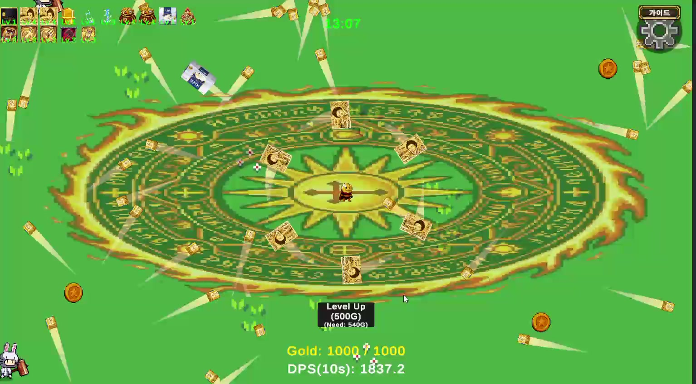

# 진화 무기의 공격 범위와 분열 조정

전투 조정 · 2026년 7월 15일 후속 작업

## 플레이에서 확인한 현상

후반 플레이 영상에서 적이 잘 보이지 않는 구간이 있었습니다. 영상을 살펴보고 코드를 분석하면서 공격이 화면 밖까지 닿고, 이펙트가 적을 가리는 점을 확인했습니다. 후반에 적을 보충하는 수가 줄어드는 현상도 함께 나타났습니다.

당시 분석 조건에서 진화 오라의 공격 반경은 10이었습니다. 화면 중심에서 위아래 끝까지의 거리인 5보다 넓었습니다. 적이 화면 안에 들어오기 전에 공격받을 수 있는 범위였습니다.

2026년 7월 15일 플레이 영상 22분 30초 지점입니다. 큰 오라와 여러 무기 궤적이 화면을 차지하는 장면입니다.

## 조정한 내용

| 대상 | 변경 |
|---|---|
| 진화 오라 | 공격 반경을 5 월드 단위로 제한하고 플레이어 크기에 따라 다시 확대되지 않게 처리 |
| 진화 근접 무기 | 공격 반경 상한 4.5, 검기 표시 크기 제한 |
| 진화 분열 무기 | 최대 분열 단계 1. 기본 조건의 이론상 동시 투사체 상한을 약 40개에서 약 20개로 제한 |

공격이 닿는 범위와 분열을 줄이고, 이펙트 표시 순서도 조정했습니다. 번개는 투사체를 8개에서 4개로 줄이는 대신 개별 피해를 2배로 높였습니다. 계산상 2차 피해 총량은 같으므로, 번개의 피해량을 낮춘 조정으로 보지는 않았습니다.

## 확인 범위

당시 기록으로는 컴파일 오류 여부와 반경·분열·표시 순서의 코드 점검까지 확인할 수 있습니다. 조정 뒤 실제 위력과 적이 잘 보이는지는 플레이 결과가 남아 있지 않습니다. FPS나 실전 피해량의 변화도 측정 결과가 없습니다.

자석의 획득 범위 개선과는 별개의 전투 조정입니다.
